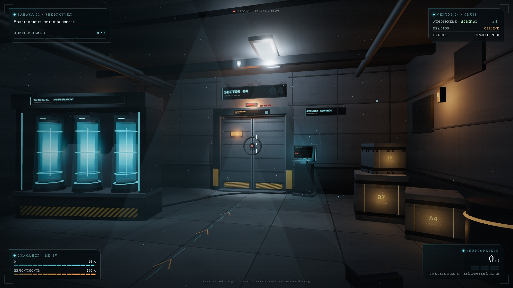
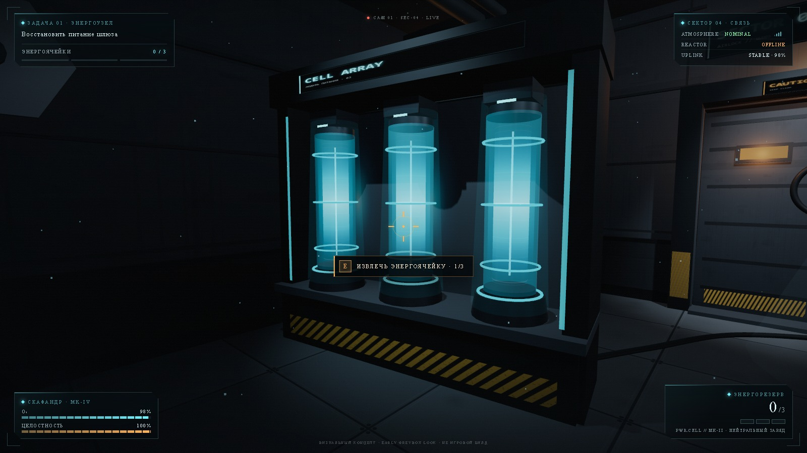
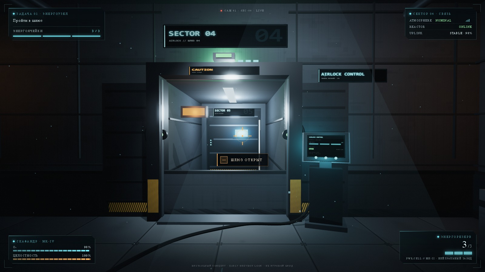
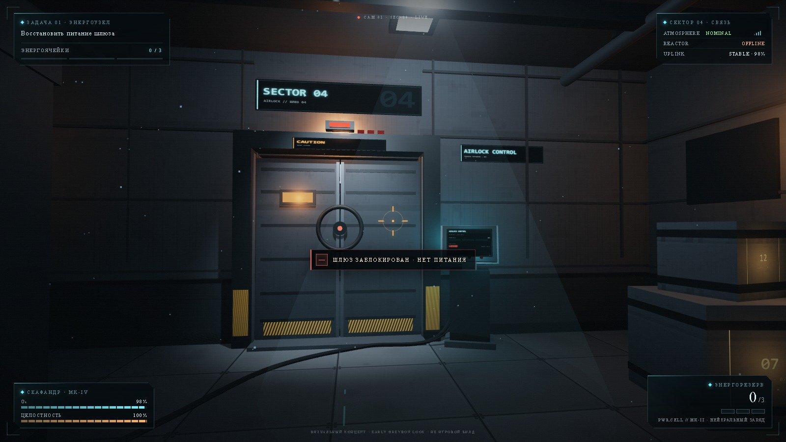
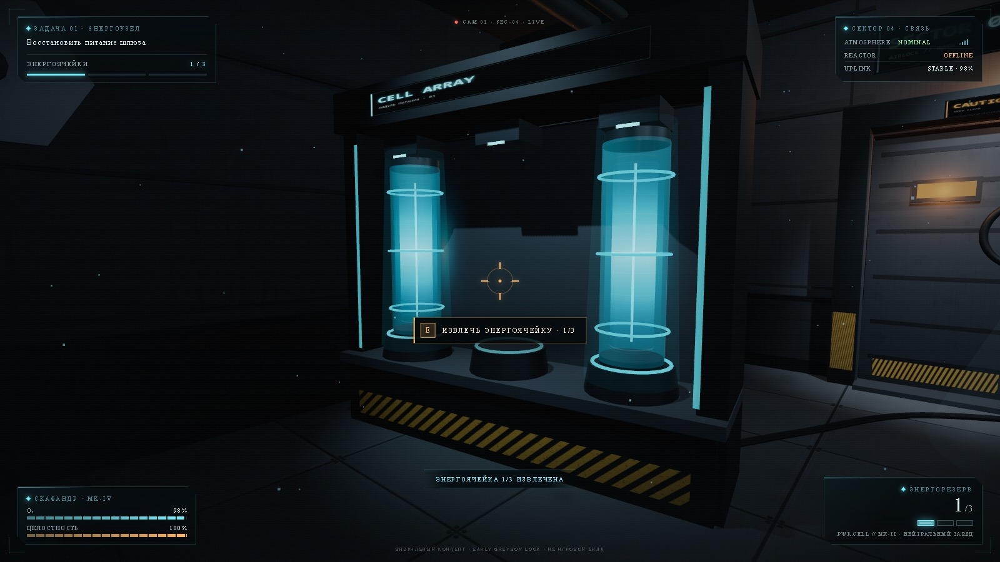
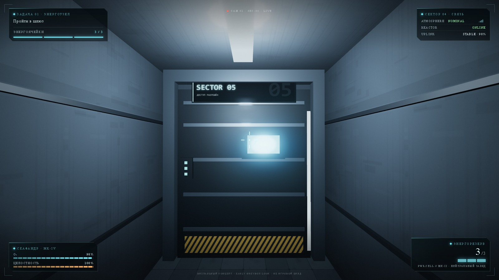
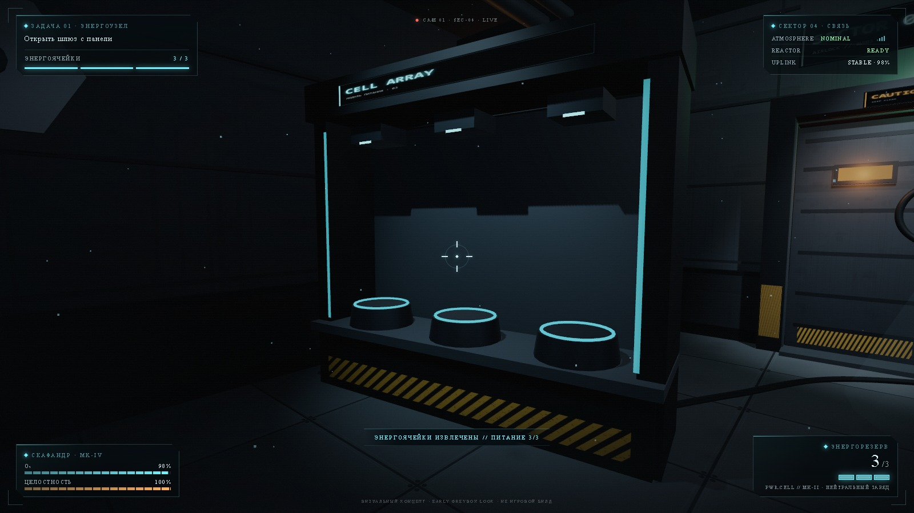

# ATLAS // SECTOR 04

Визуальный концепт игрового прототипа от первого лица: небольшая комната, тяжёлый шлюз
и три светящиеся энергоячейки. Собрал, чтобы проверить композицию кадра, свет и читаемость
HUD до того, как появится настоящая геометрия.



Это арт-исследование, а не игра: игровой цикл тут один и служит скорее площадкой для съёмки
кадров — снял ячейку со стойки, дверь переключилась в `READY`, створки разъехались, за ними
коридор в сектор 05.

## Что внутри

- **Стойка с тремя ячейками** — стеклянная труба с энергоколонкой, силовые кольца, разъёмы,
  кабель до шлюза, по нему бегут импульсы.
- **Шлюз** — створки на рельсах, колёсный замок (делится пополам вместе со створками),
  окно с тёплым светом, шевроны, статус-лампа и три индикатора ячеек над проёмом.
- **Панель управления** — экран на canvas: `LOCKED → READY → OPEN`, шкалы ячеек, статус двери.
- **Комната** — панельные стены, потолочные балки и трубы, вентиляция, люки, грузовые ящики
  с трафаретами, верстак, лестница, разметка на полу, пыль в луче света.
- **HUD** — задача с прогрессом, телеметрия сектора, витальность, энергорезерв, прицел,
  контекстная подсказка, тосты.

| | |
|---|---|
|  |  |

<details>
<summary>остальные кадры</summary>






</details>

## Запуск

Сцена собрана на ES-модулях, поэтому нужен локальный сервер — с `file://` модули не подгрузятся.

```bat
start.cmd
```

или

```powershell
powershell -ExecutionPolicy Bypass -File serve.ps1
```

и открыть <http://localhost:4173/>

## Управление

`WASD` — движение, мышь — обзор (клик по сцене захватывает курсор), `E` — взаимодействие,
`Shift` — бег, `Esc` — отпустить курсор.

## Заметки по технике

- three.js r160, WebGL2, ACES tonemapping, bloom, мягкие тени. Вся геометрия — примитивы,
  все текстуры (пол, стены, декали, экраны, знаки) рисуются в canvas на лету. Внешних
  ассетов в проекте нет вообще.
- Свет от ячеек живёт на отдельном слое: пока он был в общем слое, стеклянная труба ловила
  от точечного источника горячий блик в центре. Отдельный слой решил проблему, заодно
  оставив раковину света на полу и стойке.
- Кадры снимает функция `ATLAS.shot()` прямо на странице: она рендерит кадр, собирает
  DOM-HUD в SVG и отправляет результат на локальный сервер. Первая версия снималась
  скриншотами браузера, но окно постоянно теряло фокус и снимки падали.
- `serve.ps1` — обычный `HttpListener` на `localhost:4173` плюс один POST-эндпоинт
  для сохранения кадров.

## Что дальше

- Перенести сцену в Unreal Engine 5 и собрать на ней тот же блокаут.
- Сделать ячейки физическими предметами: подобрать, уронить, вставить в панель.
- Заменить процедурные текстуры на свои — сейчас пол и стены слишком «чистые».
- Второй шлюз и коридор в сектор 05 как отдельная зона.

## Структура

```
atlas-sector-04/
├── index.html      # разметка сцены и HUD
├── main.js         # 3D-сцена, свет, игровой цикл, API съёмки кадров
├── styles.css      # HUD, оверлеи, стартовый экран
├── serve.ps1       # локальный сервер (+ /save для кадров)
├── start.cmd       # запуск сервера и открытие браузера
├── vendor/three/   # three.js r160 (MIT) и постпроцессинг
├── media/          # три кадра для README
└── screenshots/    # остальные кадры 1600×900
```

## Процесс

Сцена собрана с помощью ИИ-ассистента: постановка кадра, свет, состав объектов и вся
режиссура кадров — мои. В репозитории лежит всё, что нужно, чтобы запустить и покрутить.

---

three.js — MIT License, © three.js authors.
